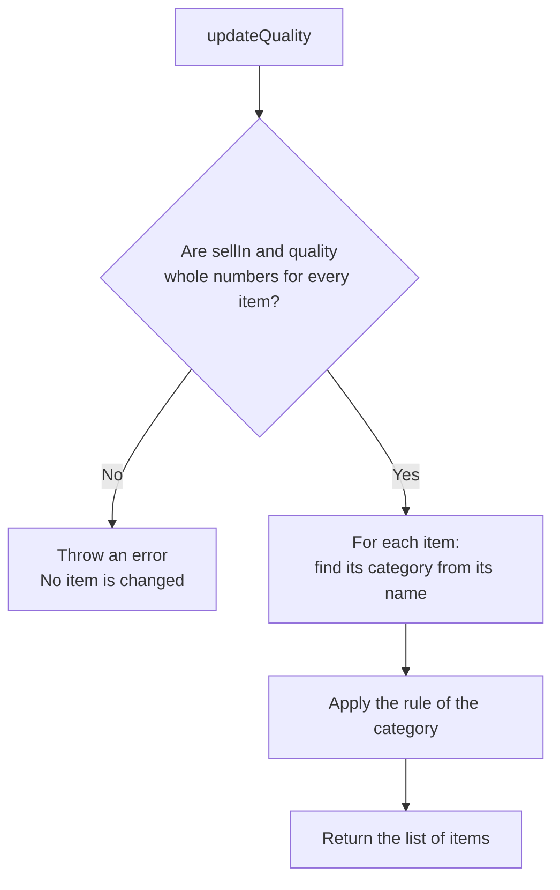

# System documentation

This document describes how the system works today. For the original rules of the kata, see [GildedRoseRequirements.md](GildedRoseRequirements.md). For how the code got to its current shape, see [refactor-plan.md](refactor-plan.md). For the commands, see the [README](../README.md).

## Purpose

The system keeps the inventory of the Gilded Rose inn up to date. Every item has a number of days left to sell it and a quality. Once a day, the system lowers the days left and changes the quality of each item according to the rules of its category.

It also ships a small program that runs a sample inventory for a number of days and prints the result, which is used to check the whole system end to end.

## Components

| File | Role |
|---|---|
| `app/gilded-rose.ts` | The business rules: the `Item` and `GildedRose` classes and the daily update |
| `app/report.ts` | `buildReport(days)`: runs a sample inventory for a number of days and returns the result as text |
| `app/program.ts` | Command-line entry point: reads the number of days and prints the report |

The dependencies go one way: `program.ts` uses `report.ts`, which uses `gilded-rose.ts`. The business rules depend on nothing else.

## Data model

**`Item`** is one line of the inventory.

| Field | Meaning |
|---|---|
| `name` | The name of the item. It decides which category the item belongs to |
| `sellIn` | The number of days left to sell the item. It becomes negative once the sell date has passed |
| `quality` | The value of the item |

The `Item` class must not be modified: this is a constraint of the kata. Its constructor accepts any value, so the checks on values live outside it.

**`GildedRose`** is the shop. It holds the list of items in its public `items` property and offers one operation, `updateQuality()`, which applies one day to every item and returns the list.

- The items are updated in place: the objects given to the shop are the ones that change.
- The list is shared, not copied: an item added to it later is updated like the others.

## The daily update



The update has two passes:

1. **Check.** Every item is checked first. If the `sellIn` or the `quality` of one item is not a whole number, the update stops with an error and no item is changed.
2. **Update.** Each item is then updated with the rule of its category.

## Categories

The category of an item comes from its name only.

| Category | How it is recognised |
|---|---|
| Aged Brie | The name is exactly `Aged Brie` |
| Backstage passes | The name is exactly `Backstage passes to a TAFKAL80ETC concert` |
| Sulfuras | The name is exactly `Sulfuras, Hand of Ragnaros` |
| Conjured | The name starts with `Conjured` |
| Normal | Everything else |

- The comparison is case-sensitive, and spaces count. `aged brie`, or `Aged Brie` followed by a space, is a normal item.
- The three exact names are tried first. `Conjured Aged Brie` is not exactly `Aged Brie`, so it is a Conjured item.

## Rules

Each rule describes what one day does to an item. "After the sell date" means that `sellIn` is below 0 once the day has been counted, which is the case when `sellIn` was 0 or less at the start of the day.

| Category | `sellIn` | `quality` before the sell date | `quality` after the sell date |
|---|---|---|---|
| Normal | −1 | −1 | −2 |
| Conjured | −1 | −2 | −4 |
| Aged Brie | −1 | +1 | +2 |
| Backstage passes | −1 | +1, +2 or +3 (see below) | Drops to 0 |
| Sulfuras | Unchanged | Unchanged | Unchanged |

**Backstage passes** gain quality faster as the concert approaches. The number of days is the `sellIn` at the start of the day.

| Days left | Quality gained |
|---|---|
| 11 or more | +1 |
| 6 to 10 | +2 |
| 1 to 5 | +3 |
| 0 or less | The quality drops to 0 |

**Bounds.** Quality moves one point at a time, and each point is allowed only if the bound is not reached yet:

- A decrease never takes the quality below 0.
- An increase never takes the quality above 50.

So a normal item at quality 1 after its sell date goes to 0, not to −1, and Aged Brie at quality 49 after its sell date goes to 50, not to 51.

### Example

| Item | Start | Day 1 | Day 2 | Day 3 | Day 4 |
|---|---|---|---|---|---|
| Normal (`sellIn` 2, `quality` 7) | 2, 7 | 1, 6 | 0, 5 | −1, 3 | −2, 1 |
| Conjured (`sellIn` 2, `quality` 11) | 2, 11 | 1, 9 | 0, 7 | −1, 3 | −2, 0 |
| Aged Brie (`sellIn` 2, `quality` 44) | 2, 44 | 1, 45 | 0, 46 | −1, 48 | −2, 50 |
| Backstage passes (`sellIn` 2, `quality` 31) | 2, 31 | 1, 34 | 0, 37 | −1, 0 | −2, 0 |
| Sulfuras (`sellIn` 0, `quality` 80) | 0, 80 | 0, 80 | 0, 80 | 0, 80 | 0, 80 |

Each cell is `sellIn, quality`.

## Values the shop accepts

**Refused.** A `sellIn` or a `quality` that is not a whole number: a decimal, `NaN`, an infinite value, a number written as text, `null` or `undefined`. The error names the item, the field and the value:

```
Invalid item "foo": quality must be a whole number, got 0.5
```

**Accepted, although outside what the requirements describe.** Whole numbers outside the 0 to 50 range are not rejected and not corrected. The bounds above only stop a move that would cross them; they do not bring a value back inside.

| Input | Result of one day |
|---|---|
| Normal item at quality 60 | 59 |
| Normal item at quality −3 | −3 |
| Aged Brie at quality 60 | 60 |
| Aged Brie at quality −3 | −2 |
| Backstage passes at quality 60, after the concert | 0 |
| Sulfuras at any quality | Unchanged; the value 80 is not enforced |

This behaviour comes from the original code and is kept on purpose. It is covered by tests so that it cannot change by accident.

## The report program

`npm start` runs `app/program.ts`, which prints the report built by `buildReport(days)`.

**Argument.** One optional argument, the number of days.

| Argument | Result |
|---|---|
| None | The report for 2 days |
| Digits only, such as `0` or `30` | The report for that number of days |
| Anything else, such as `abc`, `-3`, `2.5` or an empty text | An error message on the error output, nothing on the standard output, and exit code 1 |

**Output.** A greeting line, then one block per day from day 0 to the day requested. Each block lists the items as they are before the update of that day.

```
OMGHAI!
-------- day 0 --------
name, sellIn, quality
+5 Dexterity Vest, 10, 20
Aged Brie, 2, 0
...

-------- day 1 --------
name, sellIn, quality
+5 Dexterity Vest, 9, 19
Aged Brie, 1, 1
...
```

**Inventory.** The report always runs the same nine items, written in `app/report.ts`: two normal items, one Aged Brie, two Sulfuras, three backstage passes and one Conjured item. There is no way to give it another inventory.

## How the system is verified

| Layer | Where | What it checks |
|---|---|---|
| Rule tests | `test/unit/gilded-rose.spec.ts` | One named test per rule and per boundary, with the expected value written in the test |
| Grid test | `test/unit/gilded-rose-grid.spec.ts` | One day for 4,845 combinations of name, `sellIn` and `quality`, compared to a recorded snapshot |
| Report tests | `test/unit/report.spec.ts` | The layout of the report text |
| End-to-end tests | `test/e2e/approvals.spec.ts` | The program launched as a real process: the 30-day output against a snapshot, the default, and the refusal of invalid arguments |
| Mutation check | `scripts/mutation-check.mjs` | That the rule tests fail when a rule is changed slightly |

The two snapshots record the current behaviour. They must only be updated when a change of behaviour is intended.

Every push runs the type-check, the linter and the tests with coverage on GitHub Actions. The run fails if `app/gilded-rose.ts` or `app/report.ts` is not covered at 100%.

## Design decisions

- **Checks live outside `Item`.** The kata forbids changing that class, so `updateQuality` checks the values before using them.
- **All items are checked before any is updated.** One invalid item must not leave the inventory half updated.
- **Quality changes one point at a time.** This is what makes the bounds behave exactly as in the original code for values that start outside 0 to 50.
- **Conjured reuses the normal rule with a doubled rate.** "Twice as fast as normal items" is expressed once, in a constant.
- **Conjured is a prefix, the other categories are exact names.** The requirements speak of Conjured items as a family; the three other names were already matched exactly and were left as they were.
- **The entry point holds no logic beyond its argument.** `program.ts` is only run in a separate process by the end-to-end tests, so everything worth unit-testing is in `report.ts`.

## Known limits

- Whole numbers outside 0 to 50 are accepted as described above.
- Sulfuras is not required to have a quality of 80.
- A `null` entry in the list of items fails with a generic error, not with a clear message.
- The number of days given to the program has no upper limit.
- The report cannot run an inventory other than the built-in one.
